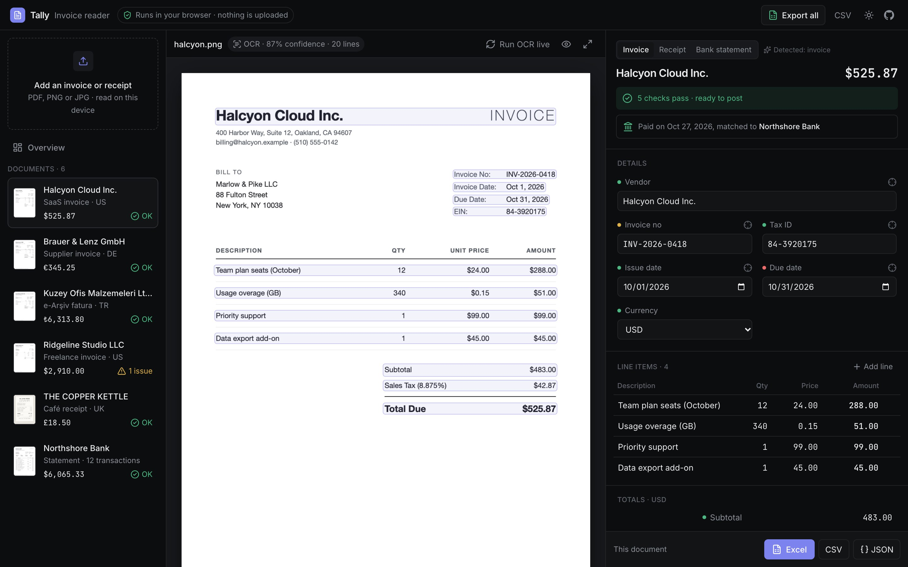
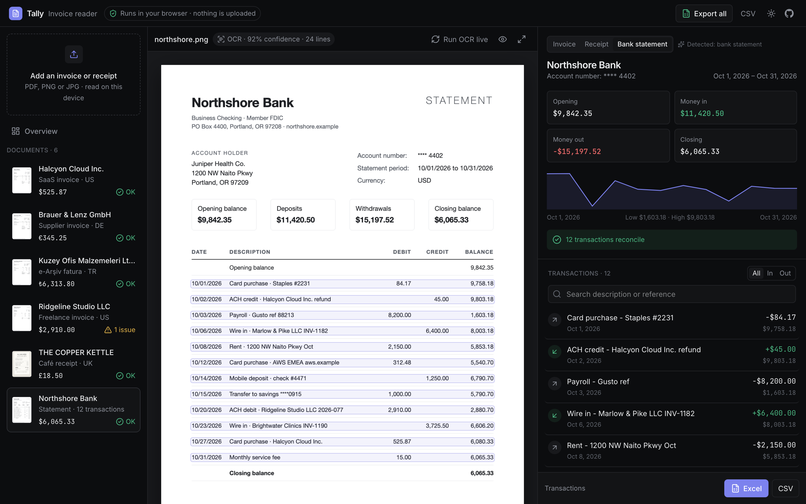
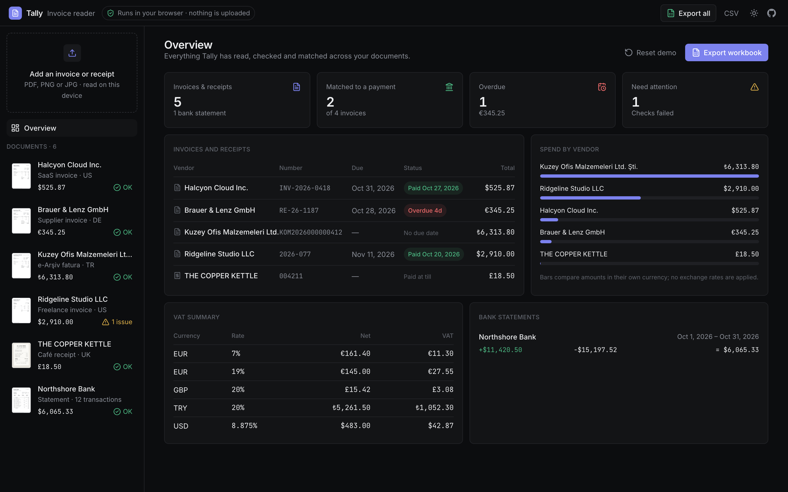
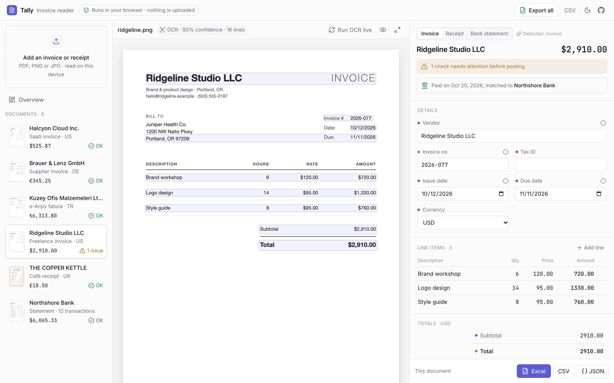
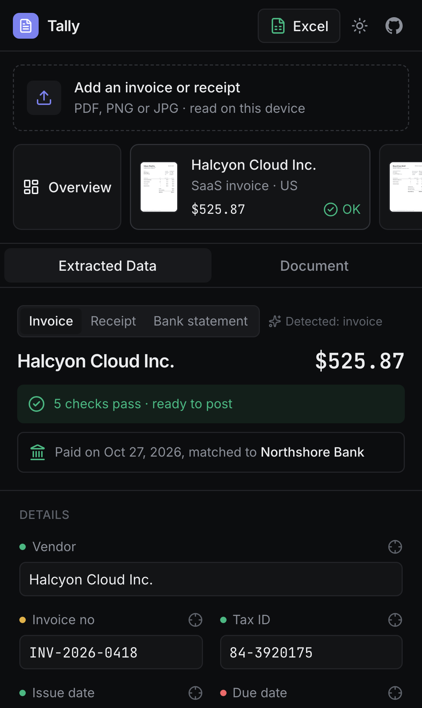

# Tally: invoices, receipts, bank statements and financial reports, read in the browser

**[Live demo](https://ozenyunus35.github.io/invoice-extractor/)** · runs entirely in your browser: no server, no API, nothing is uploaded.



Tally turns invoices, receipts and bank statements into checked, structured data. Drop in a PDF or a phone photo. It reads the text with OCR, picks out the fields a bookkeeper needs and checks that the numbers add up. It also matches invoices to the bank lines that paid them and exports everything to Excel.

## What it does

- **Reads anything people send, on your device.** Phone photos (straight from the camera on a phone), scans, PDFs, Word and Excel files, OpenDocument, CSV, plain text, saved web pages and e-mails. Photos are cropped to the paper, shadows are evened out, the page is straightened, and the text is read with the model for its language. Long documents can be photographed page by page and joined.
- **How it reads them.** Text PDFs use their own text layer, which is exact and instant. Scans and photos go through [tesseract.js](https://github.com/naptha/tesseract.js) OCR in a Web Worker. Tilted phone photos are straightened before rows are rebuilt.
- **Knows what it is looking at.** It classifies each document as an invoice, a receipt or a bank statement before reading any fields. Anything else gets an honest "not recognised" with the text it found, never invented numbers. The reviewer can switch the type with one click.
- **Invoices and receipts.** It reads:
  - vendor, tax ID, invoice number, issue and due dates, and currency;
  - line items (quantity, unit price, amount);
  - subtotal, one or more VAT rates, and the total.

  It works in English, German and Turkish, with both `1,234.56` and `1.234,56` number styles, and with day-first and month-first dates.
- **Bank statements.** It reads every transaction, joining descriptions that wrap onto several lines. It works out signs from the running balance when debit and credit sit in separate columns. Statements can be newest-first or oldest-first.
- **Checks a bookkeeper would do.**
  - Invoices: line items add up to the subtotal; subtotal + VAT = total; VAT matches its rate; quantity × price matches each line; required fields are present.
  - Statements: every balance follows from the one before; debit and credit totals match; opening balance + movements = closing balance.
- **Cross-document insights.**
  - An invoice is marked paid when a statement line pays its amount to that vendor or quotes its number.
  - Overdue invoices are flagged.
  - Possible duplicates are flagged when the same vendor and number, or the same amount and date, appear twice.
- **Overview dashboard.** Invoices with their payment status, spend by vendor, a VAT summary by currency and rate, and cash flow per statement.
- **Review and fix.** Hover a field to see where it was read on the page. Edit any value and the checks re-run as you type. Each field shows a confidence dot.
- **Export.** One workbook with Invoices, Line items and Transactions sheets, using frozen headers, filters and money formats. CSV and JSON are also available.
- **Remembers your work.** Uploads and edits stay in IndexedDB on your device. You can delete a document or reset the demo at any time.
- **Built for everyday use.** Light and dark themes, keyboard navigation (↑/↓ or j/k between documents) and a phone layout.

| Bank statement | Overview |
| --- | --- |
|  |  |

| A check that fails | On a phone |
| --- | --- |
|  |  |

## How the extraction works

There is no machine-learning service behind it: the pipeline is plain TypeScript you can read and test.

1. **Rows** (`src/lib/layout.ts`)
   - OCR engines read a two-column invoice as separate blocks, which puts "Subtotal" far away from its amount.
   - Tally regroups words by vertical position into visual rows.
   - Before grouping, it measures the page tilt from the engine's own text lines.
   - It also joins PDF text runs that split a word, and repairs letter-spaced headings.
2. **Type** (`src/lib/classify.ts`): keyword evidence plus structure. For example, a statement has many rows that start with a date and end with two amounts.
3. **Fields**
   - `src/lib/extract.ts` handles invoices and receipts.
   - `src/lib/statement.ts` handles statements.
   - Labels are matched on a folded copy of each line, so `Ş`, `ü` and `İ` still match ASCII patterns.
   - Every value keeps the row it came from.
   - Numbers use the separator style detected for the whole document.
   - When OCR misreads `%20` as `420`, the VAT rate is recovered from the amounts and marked as worked out.
4. **Checks**: `src/lib/validate.ts`, `validateStatement` and `src/lib/insights.ts`.

## How well it reads: measured, not claimed

`npm run eval` reads a generated corpus of 125 documents three ways and scores every field against the ground truth. The documents are:
- invoices in 13 locales and 9 languages, in 8 layouts (classic, modern, several VAT rates, discounts and shipping, credit notes, dense small print, dotted leaders without a table, multi-page);
- receipts and bank statements;
- financial reports in 5 languages, half of them with a deliberately broken balance sheet;
- documents it must refuse.

Each one is read as a text PDF, as a page image and as a tilted, blurred, shadowed phone photo, through the app's own in-browser pipeline (`scripts/corpus/ocr-browser.mjs`), so the numbers are what a visitor gets. The full report, failures included, is in [`corpus/REPORT.md`](corpus/REPORT.md).

| Every field right | Text PDF | Page image (OCR) | Phone photo (OCR) |
| --- | --- | --- | --- |
| Invoices (83) | 100% | 81% | 93% |
| Receipts (10) | 100% | 80% | 100% |
| Bank statements (16) | 100% | 94% | 83% |
| Financial reports (10, incl. broken ones caught) | 100% | – | – |
| Documents to refuse (6) | 100% | 100% | – |
| Word, Excel, OpenDocument, RTF, CSV, text, web page, e-mail, e-invoice XML, ZIP, misnamed files (51) | 100% | | |

### Phone photos, condition by condition

Ten invoices, receipts and a statement are each photographed under fifteen conditions (`scripts/corpus/conditions.py`); the share read with every field right:

| Condition | Every field | Total | Condition | Every field | Total |
| --- | --- | --- | --- | --- | --- |
| Dark room, sensor noise | 100% | 100% | Steep angle | 100% | 100% |
| Too much light | 90% | 100% | Curled, folded page | 100% | 100% |
| Flash hot spot | 30% | 60% | Upside down | 90% | 100% |
| Out of focus | 0% | 30% | Sideways | 80% | 100% |
| Shaky hand | 0% | 0% | Yellow bulb | 90% | 100% |
| Old low-res camera | 30% | 80% | Hand shadow across text | 20% | 70% |
| Heavy WhatsApp compression | 80% | 100% | Far away on a patterned table | 90% | 100% |
| | | | Close-up, edges cut | 90% | 100% |

Blur, camera shake, flash glare and hard shadows are the open problems: the app flags the values it is unsure of rather than guessing, and a retake fixes them.

Field by field, OCR'd invoices are 90–100% right. The misses come from the scan itself: a ₹ or ¥ sign OCR cannot read leaves the currency blank, and blurred thermal receipt photos lose digits (a single misread digit is repaired when the receipt's own total proves it). The checks and the "worth a quick look" hint show exactly which values to confirm. Damaged, half-downloaded, empty, password-protected, old binary Office, Outlook .msg, oversized and unsupported files each get a plain message (`tests/e2e/robustness.spec.ts`, `tests/e2e/hard-files.spec.ts`).

## Run it locally

```bash
npm install
npm run dev            # http://localhost:3000
npm test               # unit tests: parsing, dates, VAT, statements, real OCR output
npm run build && npm run serve   # static export, served like GitHub Pages
npm run test:e2e       # Playwright: desktop Chrome, desktop Safari, iPhone, Android
npm run corpus         # regenerate the evaluation corpus (PDFs, images, photos, OCR)
npm run eval           # score every document, writes corpus/REPORT.md
```

The sample documents are synthetic. Every company, person, address and account number in them is invented.
- Sources: `samples-src/*.html`.
- `scripts/render-samples.sh` renders them to PNG with headless Chrome.
- `scripts/ocr-samples.mjs` runs the same OCR engine the app uses and stores its real output, so the demo opens with results instantly.
- "Run OCR live" on a sample redoes that in your browser.

## Stack

- Next.js 16 (static export), React 19, TypeScript and Tailwind CSS 4.
- tesseract.js for OCR, pdf.js for PDFs and ExcelJS for exports.
- Vitest and Playwright for tests; GitHub Actions deploys to GitHub Pages.

The OCR engine and its language data load from a CDN the first time OCR runs. Text PDFs and the samples need no download at all.

## License

MIT © Yunus Ozen
